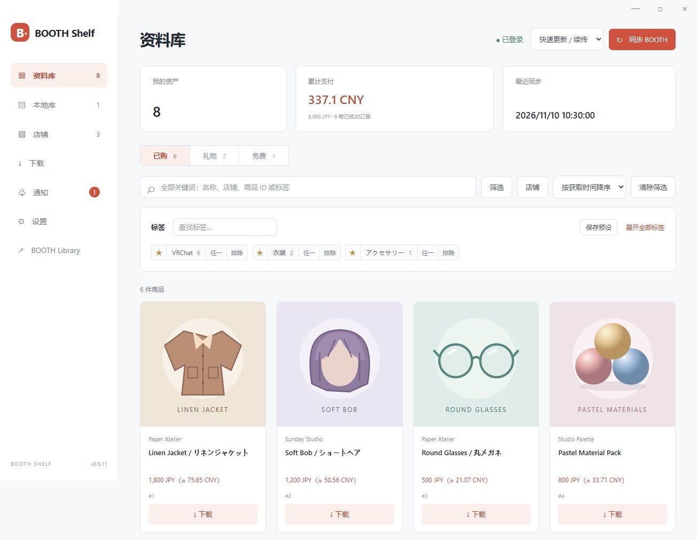
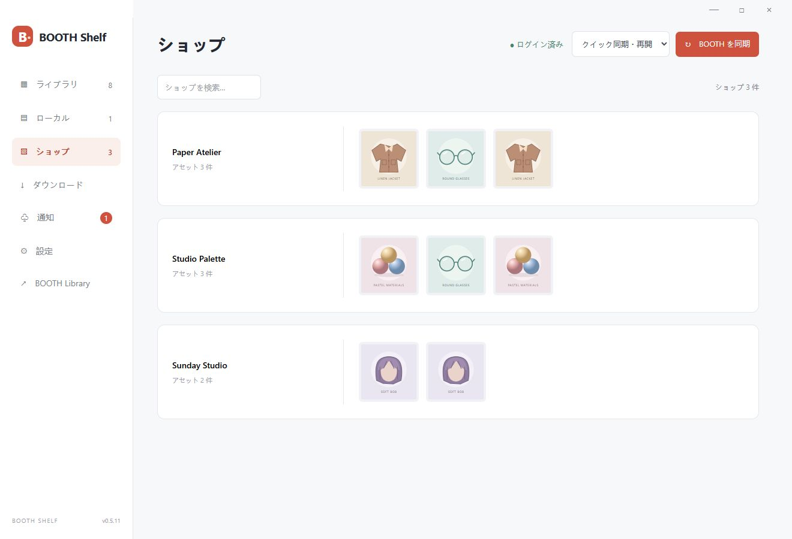
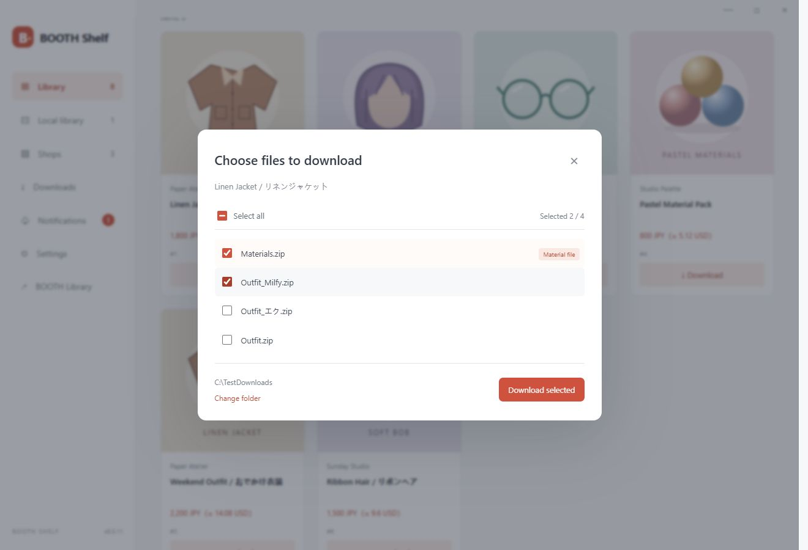

# BOOTH Shelf

**简体中文** · [日本語](docs/README.ja.md) · [English](docs/README.en.md)

把 BOOTH 资产整理到一个 Windows 资料库里：同步、筛选、下载和更新提醒。

**[下载 Windows 版](https://github.com/Shiroha129/BOOTH-Shelf/releases)** · [使用说明](docs/USAGE.zh-CN.md) · [构建](docs/DEVELOPMENT.md)

## 功能

- **整理资产**：同步已购、礼物和免费商品，启动时自动快速更新，按店铺浏览；可在设置中开启开机自启。
- **快速筛选**：标签收藏、包含／任一／排除组合，以及一键预设。
- **下载与本地库**：选择已购、礼物商品的文件下载，打开文件、定位目录或移到回收站。
- **更新提醒**：只提醒已下载资产的文件变化，默认每小时检查，间隔可调；支持托盘运行。
- **软件更新**：自动检查 GitHub 新版本，点击后下载安装并重启。
- **消费统计**：订单金额、参考汇率换算；界面支持简中、繁中、日、英、韩。

| 按店铺浏览（日文界面） | 选择下载文件（英文界面） |
| --- | --- |
|  |  |

*截图来自本地运行的界面，商品、金额和封面均为演示数据。*

## 开始使用

1. 下载 ZIP，解压并运行 `BOOTH-Shelf.exe`（Windows 10/11 x64）。
2. 已有 WebView2 的电脑直接启动；缺少时点击 **「一键安装并继续」**，软件会联网获取微软官方运行时。
3. 登录 BOOTH，首次执行「全局同步」，以后使用「快速更新」。

登录信息保存在本机。Windows 版本尚未签名；免费商品从商品网页下载。更多说明见[使用文档](docs/USAGE.zh-CN.md)。

[MIT License](LICENSE) · [第三方组件](THIRD-PARTY-NOTICES.md) · [更新记录](CHANGELOG.md)

独立第三方项目，与 BOOTH、pixiv、BOOTH Library Manager 无隶属关系。
