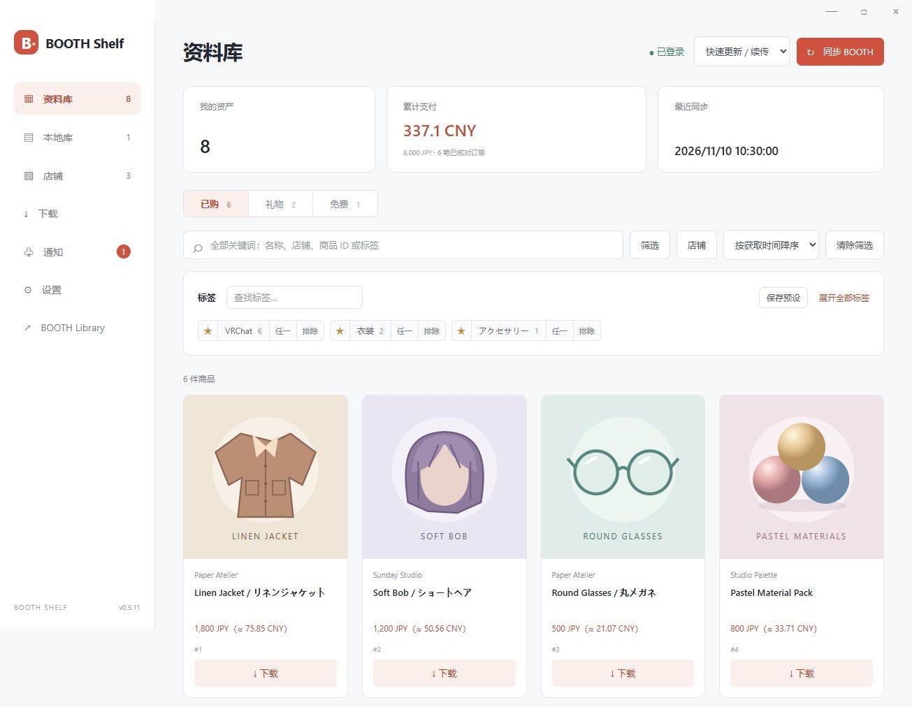
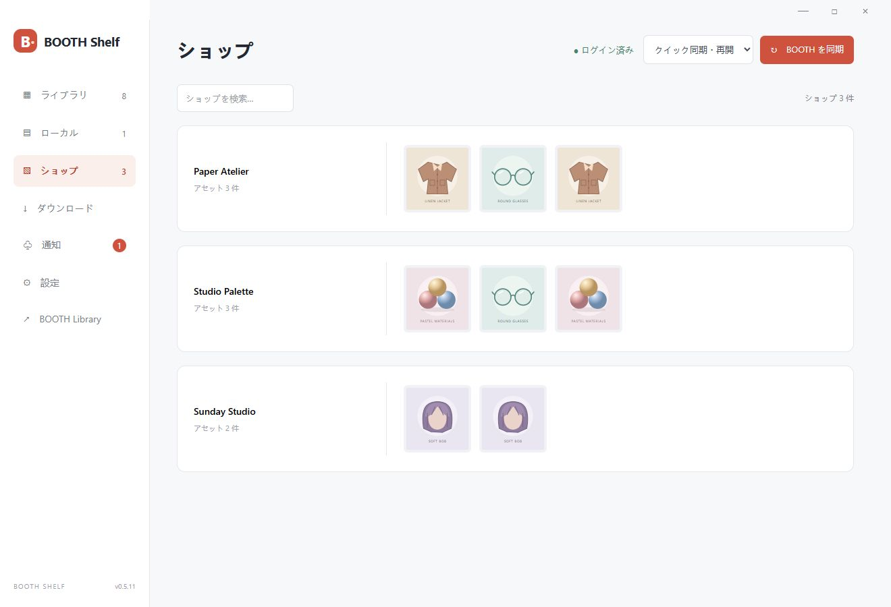
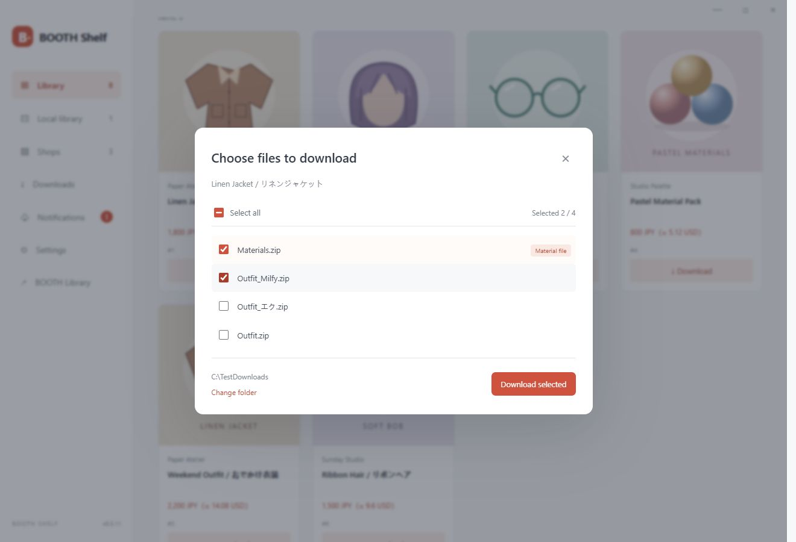

# BOOTH Shelf

[简体中文](../README.md) · [日本語](README.ja.md) · **English**

A Windows home for your BOOTH assets. Sync, filter, download, and keep up with file updates.

**[Download for Windows](https://github.com/Shiroha129/BOOTH-Shelf/releases)** · [User guide (Chinese)](USAGE.zh-CN.md) · [Build instructions](DEVELOPMENT.md)

## Features

- **Organize assets**: sync purchases, gifts and free items; browse by shop.
- **Filter quickly**: favorite tags, combine all / any / exclude rules, and save presets.
- **Download and manage files**: choose purchased or gifted files to save; open files, locate folders, or move them to the Recycle Bin.
- **Get update alerts**: check for file changes roughly every 15 minutes without downloading each asset. Runs in the tray, too.
- **Track spending**: order totals and reference currency conversion. UI available in English, Japanese, Simplified Chinese, Traditional Chinese and Korean.

| Browse by shop | Choose files to download |
| --- | --- |
|  |  |

*Screenshots show the locally running interface with fictional products, prices and illustrations.*

## Get started

1. Extract the ZIP and run `BOOTH-Shelf.exe` on Windows 10/11 x64.
2. If WebView2 is already installed, the app opens directly. Otherwise, choose **Install and continue** to fetch Microsoft's official runtime. An internet connection is required.
3. Sign in to BOOTH, run a full sync once, then use quick sync.

Login information stays on your PC. This is an unsigned preview release. Free items are downloaded from their product pages.

[MIT License](../LICENSE) · [Third-party notices](../THIRD-PARTY-NOTICES.md) · [Changelog](../CHANGELOG.md)

An independent project, unaffiliated with BOOTH, pixiv or BOOTH Library Manager.
