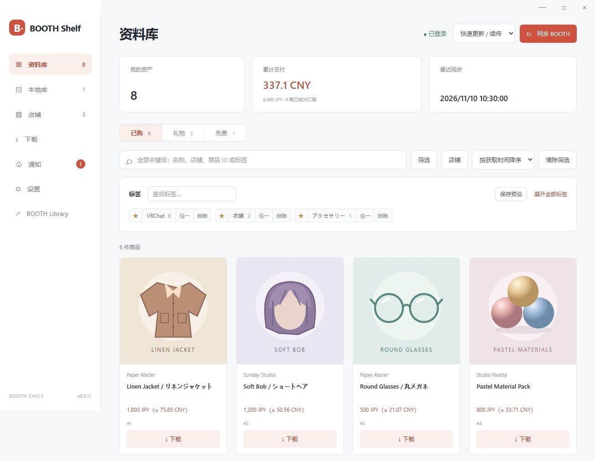
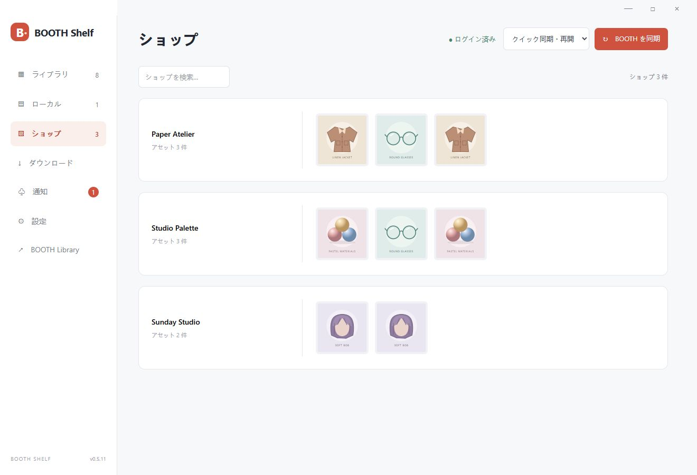
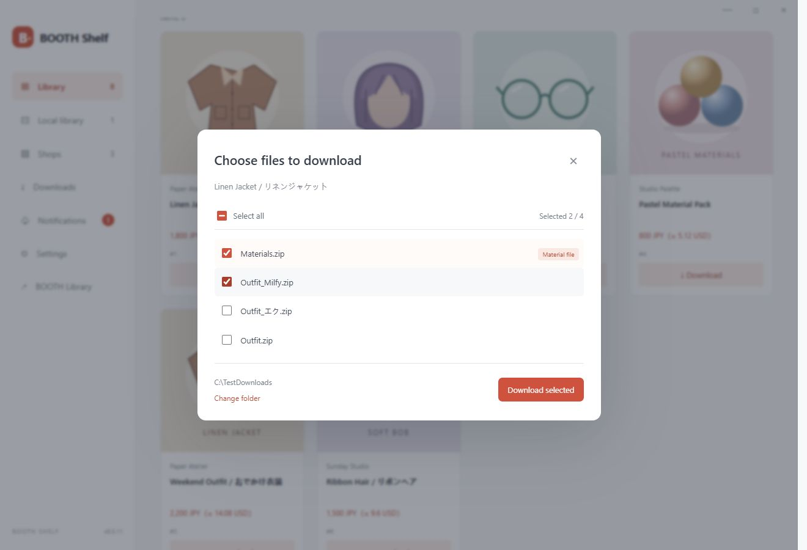

# BOOTH Shelf

[简体中文](../README.md) · **日本語** · [English](README.en.md)

BOOTH のアセットをまとめて管理する Windows アプリ。同期、絞り込み、ダウンロード、更新通知をひとつに。

**[Windows 版をダウンロード](https://github.com/Shiroha129/BOOTH-Shelf/releases)** · [詳しい使い方（中国語）](USAGE.zh-CN.md) · [ビルド方法（英語）](DEVELOPMENT.md)

## 主な機能

- **アセット管理**：購入済み・ギフト・無料アイテムを同期し、ショップ別に表示。
- **タグで絞り込み**：お気に入り、必須／いずれか／除外の組み合わせ、プリセット保存。
- **ダウンロードとローカル管理**：購入済み・ギフトのファイルを選択して保存。ファイルを開く、保存先を表示、ゴミ箱へ移動。
- **更新通知**：ダウンロード済みアセットのみ通知。標準は1時間ごとで、間隔を変更できます。トレイでの実行にも対応。
- **アプリ更新**：GitHub の新バージョンを自動確認し、アプリ内からダウンロード・更新・再起動。
- **支払額の集計**：参考為替レートで換算。UI は日本語・簡体字・繁体字・英語・韓国語に対応。

| ショップ別に表示 | ダウンロードするファイルを選択 |
| --- | --- |
|  |  |

*スクリーンショットはローカル実行した画面です。商品、金額、画像はすべてデモ用です。*

## 使い始める

1. ZIP を展開し、`BOOTH-Shelf.exe` を起動します（Windows 10/11 x64）。
2. WebView2 がある場合はそのまま起動します。ない場合は **「インストールして続行」** を押すと、Microsoft 公式のランタイムを取得します。インターネット接続が必要です。
3. BOOTH にログインし、初回は全件同期、以降はクイック同期を使います。

ログイン情報はこの PC に保存されます。Windows 版は現在コード署名されていません。無料アイテムは商品ページからダウンロードしてください。

[MIT License](../LICENSE) · [第三者コンポーネント](../THIRD-PARTY-NOTICES.md) · [変更履歴](../CHANGELOG.md)

独立した非公式プロジェクトです。BOOTH、pixiv、BOOTH Library Manager とは関係ありません。
